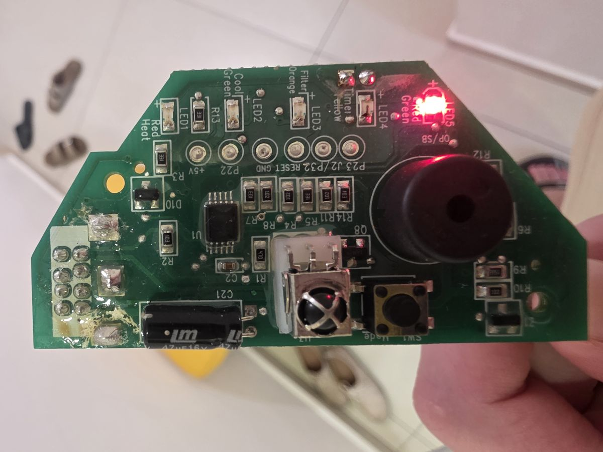
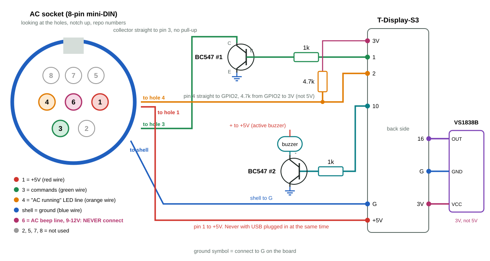

<div dir="rtl">

# עינית WiFi למזגן אלקטרה: מדריך בנייה מלא

מחליפים את העינית המקורית של המזגן (הלוחית הקטנה עם הנוריות ומקלט השלט) בלוח LILYGO T-Display-S3 עם מסך צבעוני. אחרי זה המזגן נשלט מ-Home Assistant, מגוגל ומהטלפון, והשלט המקורי ממשיך לעבוד כרגיל.

> **זה פורק (fork)** של הפרויקט [giladger/ElectraWifi](https://github.com/giladger/ElectraWifi), שהחליף את העינית ב-ESP8266. הפורק הזה מוסיף תמיכה בלוח T-Display-S3 עם מסך בעברית, כפתורים, זמזם, חיבור אוטומטי ל-Home Assistant ושליחת פקודות בתזמון חומרה. פענוח פרוטוקול השלט של אלקטרה הוא של [barakwei/IRelectra](https://github.com/barakwei/IRelectra). תודה לשניהם.

[English guide](guide.md)

---

## תוכן עניינים

1. [מה מקבלים](#מה-מקבלים)
2. [לאיזה מזגן זה מתאים](#לאיזה-מזגן-זה-מתאים)
3. [רשימת חלקים](#רשימת-חלקים)
4. [בטיחות, לקרוא לפני הכול](#בטיחות-לקרוא-לפני-הכול)
5. [המחבר של המזגן ומספור הפינים](#המחבר-של-המזגן-ומספור-הפינים)
6. [חיווט צעד אחר צעד](#חיווט-צעד-אחר-צעד)
7. [מדידות לפני שמחברים את הלוח](#מדידות-לפני-שמחברים-את-הלוח)
8. [תוכנה: בנייה וצריבה](#תוכנה-בנייה-וצריבה)
9. [חיבור ל-Home Assistant ולגוגל](#חיבור-ל-home-assistant-ולגוגל)
10. [שימוש יומיומי: מסך, כפתורים וצפצופים](#שימוש-יומיומי-מסך-כפתורים-וצפצופים)
11. [קופסה](#קופסה)
12. [פתרון תקלות](#פתרון-תקלות)
13. [נושאי MQTT](#נושאי-mqtt)

---

## מה מקבלים

- שליטה מלאה מ-Home Assistant: הדלקה וכיבוי, מצב (קירור, חימום, ייבוש, מאוורר, אוטומטי), טמפרטורה 16 עד 30, מהירות מאוורר, swing.
- המזגן מופיע ב-Home Assistant לבד (MQTT discovery), בלי לכתוב YAML.
- שליטה קולית בגוגל דרך Home Assistant.
- מסך צבעוני בעברית שמראה את מצב המזגן: טמפרטורה, מצב, מהירות מאוורר, וחיבור לרשת.
- השלט המקורי ממשיך לעבוד, גם כשה-WiFi או השרת נפלו.
- שני כפתורים על הלוח: מצב ומהירות מאוורר.
- צפצוף כשפקודה התקבלה (מהשלט, מהכפתורים או מ-Home Assistant).
- הלוח יודע אם המזגן באמת דולק, כי הוא קורא את קו הנורית "המזגן עובד".

## לאיזה מזגן זה מתאים

נבנה ונבדק על **אלקטרה EMD35T** (מיני מרכזי). מתאים למזגני אלקטרה שהעינית שלהם מתחברת לגוף המזגן בכבל עם **מחבר עגול של 8 פינים (mini-DIN)**, ושהשלט שלהם הוא השלט הרגיל של אלקטרה. בונה אחר הצליח עם אותו רעיון על ESP8266 ([issue 15 בפרויקט המקורי](https://github.com/giladger/ElectraWifi/issues/15)).

בעינית כזאת אין "מוח" שמחזיק מצב. היא רק מעבירה את האות של השלט לגוף המזגן, ומדליקה נוריות לפי מה שגוף המזגן אומר לה. לכן אפשר להחליף אותה בלוח שמדבר באותה שפה.



## רשימת חלקים

| חלק | כמות | הערה |
|---|---|---|
| LILYGO T-Display-S3 | 1 | הגרסה עם פינים מולחמים או בלי, לא משנה |
| טרנזיסטור NPN מסוג BC547 | 2 | אחד לפקודות, אחד לזמזם. 2N3904 גם עובד (סדר רגליים הפוך) |
| נגד 1k | 2 | אחד לפני כל טרנזיסטור |
| נגד 4.7k | 1 | לקו "המזגן עובד" |
| מקלט שלט VS1838B | 1 | 38 קילוהרץ, 3 רגליים |
| זמזם **אקטיבי** | 1 | כזה שמצפצף לבד כשנותנים לו מתח (לא פסיבי) |
| כבל עם מחבר mini-DIN 8 פינים | 1 | אפשר לחתוך כבל ישן, או לקנות pigtail |
| חוטים, שרוול מתכווץ | | |

כלים: מלחם, מולטימטר. סקופ לא חובה.

## בטיחות, לקרוא לפני הכול

1. ⚠️ **מלחימים ומחברים רק כשהמזגן מנותק מהחשמל בשקע.**
2. ⚠️ **אף פעם לא מחברים USB וגם את ה-5 וולט של המזגן באותו זמן.** או USB (לצריבה, על השולחן), או המזגן. בצריבה מוציאים את הכבל של המזגן מהלוח.
3. ⚠️ **פין 6 במחבר (באמצע) יושב על 9 עד 12 וולט.** לא מחברים אליו כלום. הוא ישרוף את הלוח. כדאי לחתוך אותו או לבודד אותו.
4. הקווים 3 ו-4 לא מתחברים ל-5 וולט.
5. לא מחזיקים את הכפתור התחתון של הלוח 5 שניות. זה מוחק את הגדרות ה-WiFi.
6. בודקים את כיוון הרגליים של הטרנזיסטור ושל מקלט השלט פעמיים לפני הלחמה.

## המחבר של המזגן ומספור הפינים

זה החלק שהכי קל לטעות בו (אנחנו טעינו בו שלושה שבועות, ראו [פתרון תקלות](#פתרון-תקלות)).

**כלל אחד:** כל המספרים במדריך הם המספרים של הפרויקט המקורי, כמו נקודות ההלחמה בגב העינית המקורית (1 עד 4 בטור אחד, 5 עד 8 בטור השני). **לא** המספרים המוטבעים על תקע ה-mini-DIN, כי הם שונים.

| פין | מה זה | מה נמדד בשקע ריק (המזגן בחשמל) | מתחבר? |
|---|---|---|---|
| 1 | חשמל 5 וולט | 5 וולט קבוע | כן, חוט אדום |
| 2 | נורית חימום | | לא |
| 3 | **פקודות** (האות של השלט) | 5 וולט (המזגן מחזיק אותו למעלה) | כן, חוט ירוק, דרך טרנזיסטור |
| 4 | נורית "המזגן עובד" | בערך 0.02 וולט כבוי, 0.7 וולט דולק | כן, חוט כתום |
| 5 | נורית טיימר | | לא |
| 6 | זמזם של המזגן | **9 עד 12 וולט** | **לעולם לא** |
| 7 | כפתור Mode | | לא |
| 8 | נורית קירור | | לא |
| מעטפת | אדמה | | כן, חוט כחול |

**איפה כל חור בשקע** (מסתכלים על השקע שבכבל של המזגן, על החורים, כשהחריץ למעלה):

```
        [חריץ]
     8    7    5
     4    6    1
       3    2
```

כלומר: 3 (פקודות) למטה משמאל, 1 (5 וולט) באמצע מימין, 4 (המזגן עובד) באמצע משמאל, 6 (אסור) בדיוק במרכז.

ההבדל בין 3 ל-2 קריטי: הם שכנים בשורה התחתונה. **מאמתים במדידה** (ראו [מדידות](#מדידות-לפני-שמחברים-את-הלוח)), לא לפי ציור.

## חיווט צעד אחר צעד



**הלוח:** מחזיקים את T-Display-S3 כשהמסך כלפי מטה. בשורה אחת של חורים יש `3V`, `1`, `2`, `3`, `10` ... `G`, `+5V`. בשורה השנייה יש `16`, `G`, `3V`.

**זיהוי רגליים של BC547:** הצד השטוח עם הכיתוב פונה אליך, הרגליים למטה. משמאל לימין:

```
C   B   E
```

(ב-2N3904 הסדר הפוך: E B C.)

**זיהוי רגליים של VS1838B:** העדשה העגולה פונה אליך, הרגליים למטה. משמאל לימין:

```
OUT   GND   VCC
```

### 1. חשמל ואדמה

1. החוט האדום (פין 1) לחור `+5V` של הלוח.
2. החוט הכחול (מעטפת) לחור `G`.

### 2. קו הפקודות (ירוק)

1. חור `1` של הלוח → נגד 1k → רגל B של BC547 הראשון.
2. רגל E → חור `G`.
3. רגל C → **ישר** לחוט הירוק (פין 3). בלי נגד בטור ובלי נגד ל-5 וולט.

למה טרנזיסטור: המזגן מחזיק את הקו על 5 וולט, והלוח עובד ב-3.3 וולט. הטרנזיסטור הוא כמו מתג: הלוח לוחץ עליו, והוא מושך את הקו של המזגן לאפס. ככה ה-5 וולט לא מגיעים ללוח.

### 3. קו "המזגן עובד" (כתום)

1. החוט הכתום (פין 4) **ישר** לחור `2` של הלוח.
2. נגד 4.7k מחור `2` לחור `3V`. **לא ל-5 וולט.**

למה הנגד: המזגן רק מושך את הקו הזה למטה (כמו שהוא מדליק נורית). בלי משהו שמושך למעלה, הקו תמיד נראה "דולק". הנגד הוא המשיכה למעלה. עם הנגד: בערך 3 וולט כשהמזגן כבוי, פחות מ-1 וולט כשהוא עובד.

### 4. מקלט השלט

1. `OUT` → חור `16` (בשורה השנייה).
2. `GND` → חור `G` בשורה השנייה.
3. `VCC` → חור `3V` בשורה השנייה. **לא 5 וולט.**

העדשה צריכה לראות את החדר, כמו במקום של המקלט המקורי.

### 5. הזמזם

1. חור `10` → נגד 1k → רגל B של BC547 השני.
2. רגל E → `G`.
3. רגל C → הרגל `−` של הזמזם.
4. הרגל `+` של הזמזם (הארוכה, או המסומנת) → `+5V`.

לא מחברים את הזמזם ישר לחור 10 (מושך יותר מדי זרם), ולא לפין 6 של המזגן (יצפצף בלי הפסקה).

### 6. בידוד

מבודדים כל חיבור בשרוול מתכווץ. בחורים של הלוח החוט נכנס רק 1 עד 2 מילימטר, כדי שלא ייגע במסך שבצד השני.

## מדידות לפני שמחברים את הלוח

עושים את זה **פעם אחת לפני ההפעלה הראשונה**. זה חוסך שבועות.

1. הכבל של המזגן בשקע, הלוח **לא** מחובר, המזגן בחשמל.
2. מולטימטר על וולט DC. שחור על המעטפת (כחול).
3. אדום על פין 1. צריך:

   ```
   5V
   ```

4. אדום על פין 3 (הירוק). צריך:

   ```
   5V
   ```

   אם רואים `0V`, הירוק יושב על פין 2 ולא על 3. עוצרים ומתקנים.

5. אדום על פין 4 (הכתום): כמעט אפס כשהמזגן כבוי, בערך `0.7V` כשהוא עובד. אם רואים יותר מ-`3.3V`, לא מחברים לחור 2 של הלוח (ואז צריך מחלק מתח של 10k ו-22k).
6. לא נוגעים בפין 6.

## תוכנה: בנייה וצריבה

### מה צריך במחשב

- Python 3 ו-[PlatformIO](https://platformio.org/):

  ```
  pip install platformio
  ```

- git.

### הורדה

```
git clone https://github.com/elyashivk1165/ElectraWifi-elyashivs.git
cd ElectraWifi-elyashivs
```

### הגדרות WiFi ו-MQTT

1. עורכים את הקובץ `data/homie/config.json`:
   - `wifi.ssid` ו-`wifi.password`: שם ה-WiFi והסיסמה.
   - `mqtt.host`: כתובת השרת של Mosquitto (בדרך כלל אותו מחשב של Home Assistant).
   - `mqtt.username` ו-`mqtt.password`: המשתמש של Mosquitto.
   - `device_id`: משאירים `AC` (או שם אחר באנגלית, בלי רווחים).
   - `name`: השם שיופיע ב-Home Assistant.
2. כדי שהסיסמאות לא יעלו בטעות ל-GitHub:

   ```
   git update-index --skip-worktree data/homie/config.json
   ```

### צריבה

1. מוציאים את הכבל של המזגן מהלוח. ⚠️
2. מחברים את הלוח ל-USB.
3. צורבים את הקוד:

   ```
   pio run -e t-display-s3 -t upload
   ```

4. צורבים את ההגדרות (פעם ראשונה, ובכל פעם שמשנים את config.json):

   ```
   pio run -e t-display-s3 -t uploadfs
   ```

5. מנתקים את ה-USB, ורק אז מחברים את הכבל של המזגן.

בפעם הראשונה ה-PlatformIO מוריד את כל הספריות, וזה לוקח כמה דקות. התיקון ש-Homie צריך ל-ESP32 נעשה לבד בזמן הבנייה (הסקריפט `scripts/patch_homie.py`), לא צריך לערוך קבצים ביד.

אם הלוח לא נכנס לצריבה: מחזיקים את הכפתור התחתון (BOOT), לוחצים ומשחררים את כפתור ה-RST בצד, ומשחררים את BOOT.

**עדכון אחר כך:**

```
git pull
pio run -e t-display-s3 -t upload
```

## חיבור ל-Home Assistant ולגוגל

### שרת MQTT

צריך שרת Mosquitto עם משתמש וסיסמה, ואת האינטגרציה MQTT ב-Home Assistant (Settings → Devices & Services → Add Integration → MQTT).

### המזגן מופיע לבד

ברגע שהלוח מתחבר לשרת, הוא שולח ל-Home Assistant הודעת "הנה אני" (MQTT discovery). המזגן מופיע ב-Settings → Devices & Services → MQTT בתור מכשיר בשם שכתבתם ב-`name`, עם ישות climate (אצלנו `climate.electra_ac`). לא צריך YAML. דוגמאות ה-YAML הידניות ב-[README](../README.md) נשארו בשביל הלוחות הישנים.

מהירויות המאוורר מוצגות ב-Home Assistant בתור low, medium, high, auto, ולכן הן מתורגמות לעברית בממשק.

### גוגל

אם Home Assistant כבר מחובר לגוגל (Google Assistant או Nabu Casa):

1. חושפים את ישות המזגן לגוגל.
2. אומרים לגוגל: "sync my devices" (או "סנכרן את המכשירים שלי").
3. משייכים את המזגן לחדר באפליקציית Google Home.

## שימוש יומיומי: מסך, כפתורים וצפצופים

### המסך

- משמאל: הטמפרטורה המבוקשת, ברקע בצבע של המצב (כחול קירור, כתום חימום, ירוק ייבוש, סגול אוטומטי, לבן מאוורר).
- למעלה מימין: אייקון ושם המצב בעברית.
- למטה מימין: 3 פסים של מהירות מאוורר. במצב אוטומטי הפסים כהים ויש תווית "אוטו".
- נקודה קטנה למעלה משמאל: ירוק = מחובר ל-Home Assistant, כתום = יש WiFi בלי שרת, אדום = אין WiFi.
- האנימציות נעצרות 2 דקות אחרי השינוי האחרון, כדי שהמסך לא יעבוד סתם.

### הכפתורים

- **עליון:** הדלקה, ואז כל לחיצה עוברת למצב הבא: קירור, חימום, ייבוש, מאוורר, אוטומטי, כיבוי.
- **תחתון:** מהירות מאוורר: נמוך, בינוני, גבוה, אוטומטי.
- הפקודה נשלחת בערך שנייה אחרי הלחיצה האחרונה, כך שאפשר ללחוץ כמה פעמים ברצף.
- ⚠️ החזקה של הכפתור התחתון 5 שניות מוחקת את הגדרות ה-WiFi.

### הצפצופים

- צפצוף: הפקודה הובנה ונשלחה למזגן (מהשלט, מהכפתורים או מ-Home Assistant).
- אין צפצוף אחרי לחיצה בשלט: הלוח לא הבין את האות (שלט אחר, שלט רחוק מדי, או רעש). רעש לא מצפצף בכוונה.
- בלילה, משמונה בערב עד שמונה בבוקר (שעון ישראל, מהאינטרנט), הצפצוף שקט וקצר יותר. את השעות ואת העוצמה משנים בראש `src/main.cpp` (`NIGHT_FROM_HOUR`, `NIGHT_TO_HOUR`, `NIGHT_DUTY`). עד שהשעון מתעדכן מהאינטרנט, הצפצוף בעוצמה של יום.

## קופסה

אצלנו הלוח יושב בקופסה מודפסת בתלת מימד במקום העינית המקורית. מה שחשוב בקופסה:

- חלון למסך.
- העדשה של מקלט השלט פונה לחדר, בלי פלסטיק עבה לפניה.
- חור לזמזם, אחרת לא שומעים אותו.
- גישה לשני הכפתורים (או שמוותרים עליהם).
- מקום לכבל של המזגן, בלי מתיחה על ההלחמות.

## פתרון תקלות

### המזגן לא מגיב לשום פקודה (הסיפור של שלושה שבועות)

אצלנו המזגן התעלם מכל פקודה במשך שלושה שבועות. ניסינו נגדים, טרנזיסטורים, אופטוקפלר, סקופ. בסוף התברר שהציור של המחבר היה **מבט מהצד של השקע**, והחוט הירוק ישב על **פין 2 (נורית חימום)** במקום על **פין 3 (פקודות)**. ברגע שהעברנו אותו, הכול עבד מהלחיצה הראשונה.

איך בודקים: מדידה 4 [למעלה](#מדידות-לפני-שמחברים-את-הלוח). על פין 3 בשקע ריק צריך לראות 5 וולט. על פין 2 רואים משהו אחר.

עוד דברים לבדוק:
- כיוון רגלי הטרנזיסטור (C B E).
- שה-C מחובר ישר לירוק, בלי נגד בטור.
- בונה אחד ([issue 15](https://github.com/giladger/ElectraWifi/issues/15)) נאלץ להקטין את הנגד לפני ה-B מ-1k ל-300 אוהם. אצלנו 1k עבד.

### המזגן מתעלם מהלחיצה הראשונה או השנייה

הלוח צפצף (כלומר הבין את השלט), שלח את אותה פקודה בדיוק, ובכל זאת המזגן התעלם בפעם הראשונה ועבד בשנייה. הסיבה: הלוח שלח את הפקודה ב"ספירה ידנית" של מיקרו-שניות, ובזמן שהמסך או ה-WiFi עבדו, הזמנים קצת נמתחו, והמזגן פסל את הפקודה.

התיקון: הפקודה נשלחת עכשיו בחומרה של השבב (RMT), שמחזיקה זמנים מדויקים בלי קשר למה שקורה בתוכנה. זה הדגל `-D ELECTRA_RMT` ב-`platformio.ini`. אם משהו לא עובד איתו, מוחקים את השורה הזאת וצורבים שוב, וחוזרים לשיטה הישנה.

### Home Assistant תמיד מראה "דולק" (או תמיד "כבוי")

חסר הנגד 4.7k מחור 2 ל-3V. בלעדיו מדדנו על חור 2:

```
0.10V
```

כשהמזגן כבוי, ו-

```
0.50V
```

כשהוא דולק. שניהם נראים "דולק". עם הנגד: בערך 3 וולט כבוי, פחות מ-1 וולט דולק.

### הזמזם מצפצף בלי הפסקה

הוא מחובר לפין 6 של המזגן. מנתקים, ומחברים לפי [סעיף 5](#5-הזמזם).

### הזמזם שקט מדי

צריך זמזם אקטיבי, עם הרגל `+` על 5 וולט (לא 3 וולט).

### הלוח לא מתחבר ל-WiFi

- בודקים את `config.json` וצורבים שוב עם `uploadfs`.
- ה-ESP32 עובד רק עם WiFi של 2.4 גיגה.
- אם הגדרות ה-WiFi נמחקו (החזקתם את הכפתור התחתון 5 שניות), צורבים שוב את `uploadfs`.

### הלוח נכבה ועולה מחדש לבד

יש בקוד "שומר" (watchdog): אם הלוח נתקע יותר מכמה שניות (למשל אחרי חשמל סטטי מיד שנוגעת במסך), הוא עולה מחדש לבד. זה תקין. אם זה קורה הרבה, שולחים את הלוג (למטה).

### לוג מרחוק

הלוח שולח לוג לנושא `devices/AC/debug/log`. אפשר לראות אותו כך (על המחשב של השרת):

```
mosquitto_sub -h localhost -u USER -P PASSWORD -t 'devices/AC/#' -v
```

כל פקודה מהשלט מופיעה שם בתור `IR command received: 0x...`.

## נושאי MQTT

הבסיס הוא `devices/AC/` (לפי `base_topic` ו-`device_id`).

| נושא | כיוון | ערכים |
|---|---|---|
| `power/state` + `/set` | מצב / פקודה | `on`, `off` |
| `mode/state` + `/set` | | `off`, `cool`, `heat`, `dry`, `fan_only`, `auto` |
| `temperature/state` + `/set` | | 16 עד 30 |
| `fan/state` + `/set` | | `low`, `med`, `high`, `auto` |
| `swing/state` + `/set` | | `off`, `on`, `hor`, `both` |
| `ifeel/state` + `/set` | | `on`, `off` |
| `ifeel-temperature/state/set` | פקודה | 5 עד 36 |
| `state/json/set` | פקודה | JSON עם כל השדות, ראו README |
| `reboot/trigger/set` | פקודה | `true` |
| `debug/log` | לוג | טקסט |

---

## תודות

- [giladger/ElectraWifi](https://github.com/giladger/ElectraWifi): הפרויקט המקורי שהפורק הזה מבוסס עליו.
- [barakwei/IRelectra](https://github.com/barakwei/IRelectra): פענוח פרוטוקול השלט של אלקטרה.
- הבונה מ-[issue 15](https://github.com/giladger/ElectraWifi/issues/15), על טבלת הפינים והניסיון.

</div>
