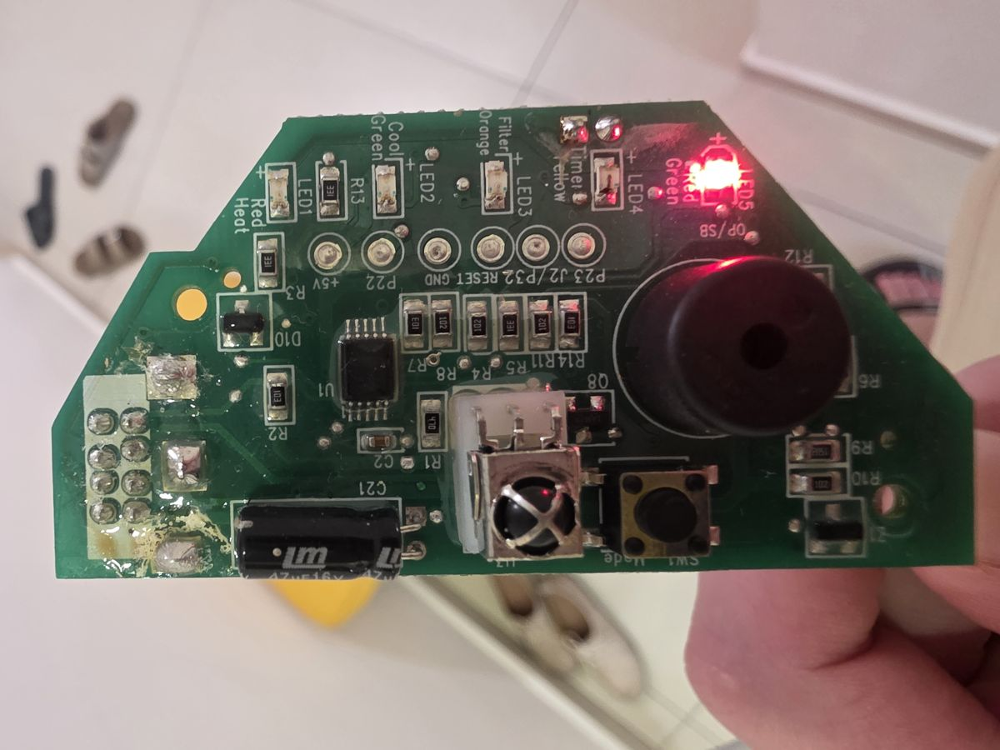
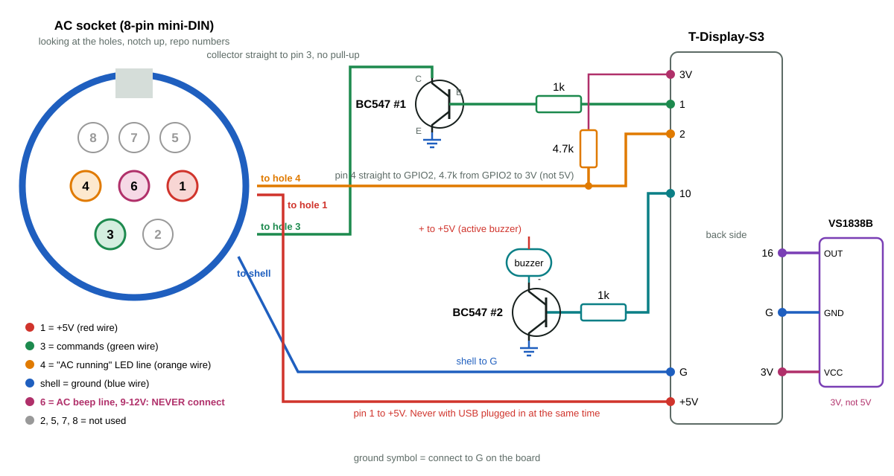

# Electra AC WiFi display: full build guide (LILYGO T-Display-S3)

Replace the indoor display board of an Electra AC (the small board with the LEDs and the remote's receiver) with a LILYGO T-Display-S3 that has a color screen. The AC is then controlled from Home Assistant, Google Assistant and your phone, and the original IR remote keeps working.

> **This is a fork** of [giladger/ElectraWifi](https://github.com/giladger/ElectraWifi), which replaced the display with an ESP8266. This fork adds a T-Display-S3 build with a Hebrew status screen, buttons, a buzzer, Home Assistant MQTT discovery and hardware-timed command output. The Electra IR protocol was decoded by [barakwei/IRelectra](https://github.com/barakwei/IRelectra). Thanks to both.

[מדריך בעברית](guide.he.md)

## Contents

1. [What you get](#what-you-get)
2. [Which AC](#which-ac)
3. [Parts](#parts)
4. [Safety](#safety)
5. [Connector and pin numbers](#connector-and-pin-numbers)
6. [Wiring](#wiring)
7. [Measure before connecting the board](#measure-before-connecting-the-board)
8. [Build and flash](#build-and-flash)
9. [Home Assistant and Google](#home-assistant-and-google)
10. [Screen, buttons and beeps](#screen-buttons-and-beeps)
11. [Enclosure](#enclosure)
12. [Troubleshooting](#troubleshooting)
13. [MQTT topics](#mqtt-topics)

## What you get

- Full control from Home Assistant: power, mode (cool, heat, dry, fan, auto), 16-30 °C, fan speed, swing.
- The AC shows up in Home Assistant by itself (MQTT discovery), no YAML.
- Voice control through Home Assistant's Google Assistant link.
- A Hebrew color status screen: set temperature, mode, fan speed, network link.
- The original remote keeps working, even while WiFi or MQTT is down.
- Two on-board buttons: mode and fan speed.
- A beep when a command was understood (remote, buttons or Home Assistant).
- The real power state, read from the AC's "running" LED line.

## Which AC

Built and tested on an **Electra EMD35T** (mini-central). It should fit Electra units whose display connects to the indoor unit with an **8-pin round mini-DIN cable** and that use the standard Electra remote. Another builder got the same idea working on an ESP8266 ([upstream issue 15](https://github.com/giladger/ElectraWifi/issues/15)).

The display holds no state of its own. It passes the remote's signal to the main board and lights the LEDs the main board tells it to, so a board that speaks the same signal can take its place.



## Parts

| Part | Qty | Note |
|---|---|---|
| LILYGO T-Display-S3 | 1 | |
| NPN transistor BC547 | 2 | commands and buzzer. 2N3904 works too (reversed pinout) |
| 1k resistor | 2 | one in front of each transistor base |
| 4.7k resistor | 1 | pull-up for the "running" line |
| VS1838B IR receiver | 1 | 38 kHz |
| **Active** buzzer | 1 | sounds by itself on DC |
| 8-pin mini-DIN cable / pigtail | 1 | |
| Wire, heat shrink | | |

Tools: soldering iron, multimeter. A scope helps but is not required.

## Safety

1. ⚠️ Solder and connect only with the AC unplugged from the mains.
2. ⚠️ **Never power the board from USB and from the AC's 5V at the same time.** Unplug the AC cable before flashing.
3. ⚠️ **Pin 6 (centre) sits at 9-12V.** Do not connect it to anything.
4. Lines 3 and 4 never go to 5V.
5. Do not hold the lower board button for 5 seconds: that erases the WiFi settings.
6. Double-check transistor and IR receiver pinouts before soldering.

## Connector and pin numbers

All numbers are the **upstream repo numbers**, the same as the solder pads on the back of the original display (1-4 in one column, 5-8 in the other). They are **not** the numbers moulded on the mini-DIN plug.

| Pin | Function | Empty socket, AC powered | Used |
|---|---|---|---|
| 1 | 5V | steady 5V | yes, red wire |
| 2 | Heat LED | | no |
| 3 | **Commands** (IR signal) | 5V (the AC holds it up) | yes, green wire, through a transistor |
| 4 | "Running" LED, low = on | about 0.02V off, 0.7V running | yes, orange wire |
| 5 | Timer LED | | no |
| 6 | AC beep | **9-12V** | **never** |
| 7 | Mode button | | no |
| 8 | Cool LED | | no |
| shell | ground | | yes, blue wire |

Hole positions, looking into the **socket** on the AC's cable, notch up:

```
        [notch]
     8    7    5
     4    6    1
       3    2
```

Pins 3 and 2 are neighbours on the bottom row. **Confirm with a meter** (next sections), not from a drawing.

## Wiring



BC547, flat side facing you, legs down, left to right: `C B E` (2N3904: `E B C`).
VS1838B, lens facing you, legs down, left to right: `OUT GND VCC`.

1. **Power:** pin 1 (red) to `+5V`, shell (blue) to `G`.
2. **Commands:** `GPIO1` → 1k → base of BC547 #1; emitter → `G`; collector **straight** to pin 3 (green). No series resistor, no pull-up. The transistor pulls the AC's 5V line to 0, so 5V never reaches the 3.3V chip.
3. **Running line:** pin 4 (orange) **straight** to `GPIO2`, plus 4.7k from `GPIO2` to `3V` (not 5V). The AC only pulls this line down; the resistor pulls it up. Result: about 3V when off, under 1V when running. The firmware reads it with the ADC and hysteresis.
4. **IR receiver:** `OUT` → `GPIO16`, `GND` → `G`, `VCC` → `3V` (other pin row). Keep the lens facing the room.
5. **Buzzer:** `GPIO10` → 1k → base of BC547 #2; emitter → `G`; collector → buzzer `−`; buzzer `+` → `+5V`. Not straight from the pin, and not on the AC's pin 6.
6. Insulate every joint. Push wires only 1-2 mm through the board holes so they do not touch the screen.

## Measure before connecting the board

Cable in the socket, board **not** connected, AC powered, meter on DC volts, black probe on the shell:

1. Pin 1: `5V`.
2. Pin 3: `5V`. If you read `0V`, the green wire is on pin 2. Stop and move it.
3. Pin 4: near 0 when off, about `0.7V` when running. If it ever exceeds `3.3V`, do not connect it straight to `GPIO2`; use a 10k/22k divider.
4. Do not touch pin 6.

## Build and flash

```
pip install platformio
git clone https://github.com/elyashivk1165/ElectraWifi-elyashivs.git
cd ElectraWifi-elyashivs
```

Edit `data/homie/config.json` (WiFi SSID and password, MQTT host, user and password, `device_id`, `name`), then keep it out of git:

```
git update-index --skip-worktree data/homie/config.json
```

Unplug the AC cable, connect USB, then:

```
pio run -e t-display-s3 -t upload
pio run -e t-display-s3 -t uploadfs
```

`uploadfs` writes the settings; repeat it whenever `config.json` changes. Homie's ESP32 fixes are applied automatically at build time by `scripts/patch_homie.py`. If the board does not enter flashing mode, hold BOOT (lower button), tap RST, release BOOT.

Update later with `git pull` and the `upload` command.

## Home Assistant and Google

1. Run a Mosquitto broker with a user and password, and add the MQTT integration in Home Assistant.
2. When the board connects it publishes a discovery message. The AC appears under Settings → Devices & Services → MQTT as a climate entity named after `name` (ours is `climate.electra_ac`). The manual YAML in the [README](../README.md) is only for the older boards.
3. Fan speeds are announced as `low`, `medium`, `high`, `auto` so Home Assistant translates them; the device topics keep `med`.
4. Google: expose the entity through Home Assistant's Google Assistant link, say "sync my devices", and assign the AC to a room in Google Home.

## Screen, buttons and beeps

- **Screen:** large set temperature on the left, on a gradient in the mode's color; mode icon and Hebrew name top right; 3 fan bars bottom right (auto = dim bars plus an "auto" badge); a link dot top left (green = MQTT, orange = WiFi only, red = no WiFi). Animations stop 2 minutes after the last change.
- **Upper button (GPIO14):** on, then cool → heat → dry → fan → auto → off.
- **Lower button (GPIO0):** fan low → med → high → auto. The command is sent about a second after the last press. Holding it 5 seconds triggers Homie's reset (erases WiFi/MQTT settings).
- **Beeps:** a beep = command understood and sent (remote, buttons or Home Assistant). No beep after a remote press = the signal was not decoded (another remote, too far, or noise); noise stays silent on purpose. From 20:00 to 08:00 Israel time (internet clock) the beep is shorter and softer (the active buzzer chopped at 2.7 kHz); change `NIGHT_FROM_HOUR`, `NIGHT_TO_HOUR` and `NIGHT_DUTY` in `src/main.cpp`. Until the clock is set, beeps use the day volume.

## Enclosure

Ours sits in a 3D-printed box in place of the original display. Leave a window for the screen, keep the IR lens facing the room without thick plastic in front, add a hole for the buzzer, give access to the buttons, and strain-relieve the AC cable.

## Troubleshooting

### The AC ignores every command (our three weeks)

For three weeks our AC ignored every command. We tried resistors, transistors, an optocoupler and a scope. The cause: the connector drawing was the **socket** view, so the green wire sat on **pin 2 (heat LED)** instead of **pin 3 (commands)**. Once moved, the AC answered the first press. Check it with the measurement above: pin 3 on an empty socket reads 5V.

Also check the transistor pinout (C B E) and that the collector goes straight to pin 3. One builder ([issue 15](https://github.com/giladger/ElectraWifi/issues/15)) had to lower the base resistor from 1k to 300 Ω; 1k worked for us.

### The AC ignores the first one or two presses

The board beeped (the remote was understood) and sent the same code, yet the AC ignored the first press and took the second. The frame used to be bit-banged with `delayMicroseconds()`, and screen drawing or WiFi occasionally stretched its timing. The frame is now played by the ESP32's RMT peripheral, which keeps exact timing (`-D ELECTRA_RMT` in `platformio.ini`). To go back to the old method, remove that line and reflash.

### Home Assistant always shows "on"

The 4.7k pull-up from `GPIO2` to `3V` is missing. Without it we measured 0.10V off and 0.50V on, both read as "on".

### The buzzer never stops

It is wired to the AC's pin 6. Move it to the transistor circuit.

### The buzzer is too quiet

Use an active buzzer, with `+` on 5V.

### No WiFi

Check `config.json` and run `uploadfs` again. The ESP32 needs 2.4 GHz WiFi.

### The board restarts by itself

A loop watchdog restarts the board if the main loop hangs for a few seconds (for example after a static discharge from a hand near the screen). That is expected; if it happens often, check the log below.

### Remote log

The board publishes a debug log on `devices/AC/debug/log`:

```
mosquitto_sub -h localhost -u USER -P PASSWORD -t 'devices/AC/#' -v
```

Every remote press shows up as `IR command received: 0x...`.

## MQTT topics

Base: `devices/AC/` (from `base_topic` and `device_id`).

| Topic | Values |
|---|---|
| `power/state`, `power/state/set` | `on`, `off` |
| `mode/state`, `mode/state/set` | `off`, `cool`, `heat`, `dry`, `fan_only`, `auto` |
| `temperature/state`, `temperature/state/set` | 16-30 |
| `fan/state`, `fan/state/set` | `low`, `med`, `high`, `auto` |
| `swing/state`, `swing/state/set` | `off`, `on`, `hor`, `both` |
| `ifeel/state`, `ifeel/state/set` | `on`, `off` |
| `ifeel-temperature/state/set` | 5-36 |
| `state/json/set` | JSON with all fields, see the README |
| `reboot/trigger/set` | `true` |
| `debug/log` | text |

## Credits

- [giladger/ElectraWifi](https://github.com/giladger/ElectraWifi), the original project this fork is based on.
- [barakwei/IRelectra](https://github.com/barakwei/IRelectra), the Electra IR protocol.
- The builder in [issue 15](https://github.com/giladger/ElectraWifi/issues/15), for the pin continuity table.
